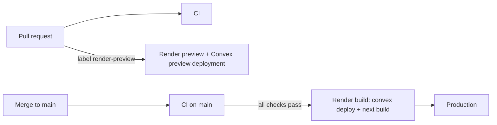

# CI, deploys and PR previews

Three things run without anyone starting them: CI on GitHub Actions, the production deploy on Render, and an opt-in preview for a pull request. Convex is the database and backend, so Render hosts one web service and nothing else. Everything is sized to cost $0 a month; the [cost table](#costs) says what would change that.

Nothing on Render exists until a person does the [one-time setup](#one-time-setup-human-only). Until then only CI runs.

## CI

`.github/workflows/ci.yml` runs one job on every pull request and on every push to `main`: `pnpm lint`, `pnpm skills:check`, `pnpm test` and `pnpm build` (which runs `pnpm typecheck` first). A run takes under a minute. The repository is public, so GitHub does not bill the minutes.

- **One job, one install.** The checks themselves take seconds, so separate jobs would spend more time on installs than on checks.
- **A newer push cancels the run it supersedes**, per branch or pull request.
- **Changes that only touch Markdown or `.scratch/` start no run.** The vendored skills and `docs/skills.md` are the exception, because `pnpm skills:check` verifies them.
- **Cache:** the pnpm store, keyed by `pnpm-lock.yaml`.
- **Versions come from the repository:** pnpm from `packageManager` in `package.json`, Node from `.node-version`. Render reads the same two.
- **The mirror does not run it.** Every commit is also pushed to `platanus-hack/platanus-hack-26-cl-team-16`. The job has an `if:` on the repository name, so on the mirror it is skipped and uses no minutes.
- **`pnpm smoke` is not in CI.** It starts `next dev`, which relies on Clerk keyless mode to create a temporary Clerk app. On a GitHub runner Clerk did not create one, and the page failed with `Missing publishableKey`. Smoke stays a check you run before opening a pull request, as `AGENTS.md` requires. To run it in CI, claim the Clerk app (step 5 below), add its two development keys as Actions secrets, and add a smoke step that reads them.

## Production

`render.yaml` is a Render Blueprint with one web service on the Free instance type, linked to `main`.

1. A commit lands on `main` and CI runs on it.
2. Render waits for the commit's GitHub checks (`autoDeployTrigger: checksPass`) and deploys only when all of them pass: the `check` job and any other app's check, such as GitGuardian's. A failed or cancelled run deploys nothing.
3. Render runs `scripts/render-build.sh`, which installs dependencies and runs `convex deploy --cmd 'pnpm build'`. That one command builds the Next.js app with `NEXT_PUBLIC_CONVEX_URL` set to the production Convex deployment, then pushes the Convex functions and schema to that same deployment. If the build or the push fails, the deploy fails and the previous version keeps serving.
4. Render starts `next start` and switches traffic once `/` answers.

The `buildFilter` in `render.yaml` keeps deploys from spending build minutes on changes that cannot alter the app: Render skips a commit that only touches Markdown, `.agents/`, `.capy/`, `.github/`, `.scratch/`, `licenses/` or `tests/`. Every commit that Render does build has had a CI run, because CI skips only Markdown and `.scratch/`.

The Free instance stops after 15 minutes without traffic, and the next request waits about a minute while it starts. That is the price of $0. For a demo, change `plan` in `render.yaml` to `0.5c-512mb` (see [Costs](#costs)). Do not add a service that pings the app to keep it awake: it uses up the month's free instance hours, and when they run out Render suspends every Free service in the workspace.

Seed data is not loaded in production. `pnpm seed` runs `seed:ensure` against the deployment a person has selected.

## PR previews

A preview is a second, temporary copy of the web service at its own `onrender.com` URL, with its own Convex backend and data. It exists only for pull requests that ask for one.

- **Ask for one:** add the label `render-preview` to the pull request. Render builds the branch and shows the URL as a deployment on the pull request. Each later push to the branch redeploys it.
- **Its backend:** the build script sees `IS_PULL_REQUEST=true` and deploys to a Convex preview deployment named after the branch, using `CONVEX_PREVIEW_DEPLOY_KEY`. `seed:ensure` fills its empty tables with the sample data. Later pushes reuse the same deployment and its data.
- **Remove it:** take the label off, or merge or close the pull request. Render deletes the preview instance.
- **Idle cost:** none. A preview is a Free instance too, so it stops after 15 minutes without traffic.
- **Convex deletes a preview deployment 5 days after it was created.** The Render preview then shows errors until the next push or a manual deploy from the Render Dashboard, which creates a new deployment.
- A pull request that only changes files ignored by `buildFilter` gets no preview.

Things to know:

- A preview instance copies the variables of the base service when it is created, including the production deploy key. The build script therefore picks the key from `IS_PULL_REQUEST` and refuses a preview build with a production key and a production build with a preview key. Later changes to the base service's variables do not reach previews that already exist.
- Convex functions in a preview read their variables from the project's default environment variables for preview deployments, not from Render.
- Previews need the Hobby workspace plan only. Render's full "preview environments" need the Pro plan ($25/month) and are for projects with several Render services or Render databases, which this app does not have.
- The repository is public. A Render employee wrote in 2021 that a pull request from a fork does not create a preview, and the current docs do not mention forks. Check it before you rely on it: a preview build runs the pull request's code with the service's secrets.

## Costs

Prices and limits come from Render's and Convex's pricing pages and docs, read on 2026-11-21.

| Resource | Plan | Monthly cost at rest | Monthly cost in use | What spends |
| --- | --- | --- | --- | --- |
| GitHub Actions | Public repository, standard runner | $0 | $0 | Nothing is billed. Each run takes under a minute. |
| Render workspace | Hobby | $0 | $0 | Includes 500 build minutes, 750 Free instance hours and 5 GB of outbound bandwidth a month. |
| Render web service (production) | Free: 0.1 CPU, 512 MB | $0 | $0 | Instance hours while it is awake. Build minutes for each deploy. |
| Render PR preview (each) | Free, same as production | $0 | $0 | The same two budgets, only while the label is on and the instance is awake. |
| Convex | Free | $0 | $0 | 1,000,000 function calls, 0.5 GB of storage and 1 GB of database I/O a month. 40 deployments for the team. |
| Clerk | Free, development instance | $0 | $0 | Capped at 100 users. |

What changes the bill:

- **Build minutes run out.** With a payment method on the workspace, Render buys more at $5 per 1,000 minutes. With no payment method, or with a spend limit that is reached, Render stops building until next month and the app keeps running on its last build. Keep the workspace without a payment method, or set a spend limit (step 10 below).
- **Free instance hours run out.** Render suspends every Free web service until next month. Production alone uses at most 744 hours when it never sleeps, so previews only fit while production is allowed to sleep.
- **An always-on production.** `plan: 0.5c-512mb` costs $7 a month, billed by the second (about $0.23 a day). Each preview then also costs $7 a month for as long as it exists, because a preview uses its base service's plan. Take the label off when you finish.
- **Bandwidth above 5 GB.** Render bills the extra, or suspends the Free services when the workspace has no payment method.
- **A new entry in `render.yaml`.** Render creates it on the next sync. Review changes to that file as a cost decision.
- **Convex above the Free limits.** Nothing is billed: new writes start to fail.
- **Real LLM or business providers.** `LLM_PROVIDER=gateway` and the other variables in `docs/development.md` spend those providers' credits. The defaults are offline and free.

## One-time setup (human only)

No agent does these steps. None of them has been done yet: the repository still uses a local anonymous Convex deployment and Clerk keyless mode, and `convex/auth.config.ts` has no provider.

Clerk keyless mode works only under `next dev`. A deployed build runs `next start`, which answers every request with an error (`Missing publishableKey`) unless `NEXT_PUBLIC_CLERK_PUBLISHABLE_KEY` and `CLERK_SECRET_KEY` are set. The publishable key is compiled into the build, so both must be on the Render service before the first deploy.

### Convex

1. In a terminal, `npx convex login`, then `npx convex dev --configure=new` to create the cloud project. Stop it once it runs. This is step 1 of "Switch to real accounts" in `AGENTS.md`.
2. In the [Convex Dashboard](https://dashboard.convex.dev), create the project's production deployment if it has none. On that deployment's Deployment Settings page, General tab, click "Generate Production Deploy Key" and enable the `deployment:deploy` permission. The key starts with `prod:`. It becomes `CONVEX_DEPLOY_KEY` on Render.
3. On the project's Settings page, click "Generate Preview Deploy Key". The key starts with `preview:`. It becomes `CONVEX_PREVIEW_DEPLOY_KEY` on Render.
4. Only when the app should use real providers: set the variables from `docs/development.md` (for example `LLM_PROVIDER` and `AI_GATEWAY_API_KEY`) on the production deployment (Settings, Environment Variables), and as default environment variables for preview deployments (Project Settings).

### Clerk

5. Claim the app: run `pnpm dev`, open the page and follow the "Configure your application" prompt. In the [Clerk Dashboard](https://dashboard.clerk.com), API keys, copy the publishable key (`pk_test_...`) and the secret key (`sk_test_...`). These are development-instance keys. Clerk accepts them on a host's own domain such as `onrender.com`, previews included, and caps the instance at 100 users.
6. Activate the Convex integration in Clerk and copy the Frontend API URL. In `convex/auth.config.ts`, uncomment the provider and paste the URL as a literal `domain`, in a pull request. Until this merges, the deployed app runs but Convex treats every user as signed out, as it does locally today.
7. A Clerk production instance (`pk_live_...`) needs a domain you own and DNS records on it, so it cannot use an `onrender.com` address. Create it only when the app has its own domain. Production and previews would then use different Clerk instances, and `auth.config.ts` would need the `CLERK_JWT_ISSUER_DOMAIN` variable per Convex deployment instead of a literal.

### Render

8. In the [Render Dashboard](https://dashboard.render.com), connect the GitHub account and give Render access to `HugoCL/platanus-hack-26-cl-team-16` only.
9. New, Blueprint, pick the repository and the `main` branch. Render reads `render.yaml`, shows the one service it will create, and asks for the four secret values. They live on the service's Environment page afterwards. No environment group is needed for a single service.

   | Variable | Value | Used |
   | --- | --- | --- |
   | `CONVEX_DEPLOY_KEY` | Step 2 | Production build |
   | `CONVEX_PREVIEW_DEPLOY_KEY` | Step 3 | Preview builds |
   | `NEXT_PUBLIC_CLERK_PUBLISHABLE_KEY` | Step 5 | Build and runtime |
   | `CLERK_SECRET_KEY` | Step 5 | Runtime |

10. Leave the workspace without a payment method. If it has one, set a spend limit under Workspace Settings, Build Pipeline.
11. After the first deploy, open the service's Previews tab and check that pull request previews are set to Manual.

### GitHub

12. Create the label once: `gh label create render-preview --repo HugoCL/platanus-hack-26-cl-team-16`.
13. GitHub Actions needs no secrets. CI is offline and the deploy runs on Render. Only a future smoke step would need the Clerk development keys.
14. Put the production URL in `deploy-url` in `platanus-hack-project.jsonc`.

## Not verified until the first deploy

These could not be tested without creating the service. Check them on the first deploy and correct this page.

- How long a Render build takes, and so how many deploys fit in 500 minutes. If a build takes 4 minutes, about 125.
- Which pnpm Render's Node runtime ships. `scripts/render-build.sh` installs the version pinned in `package.json` when the two differ.
- That the health check on `/` passes with real Clerk keys.
- That Render waits for the `check` job when another app's check, such as GitGuardian's, finishes first.
